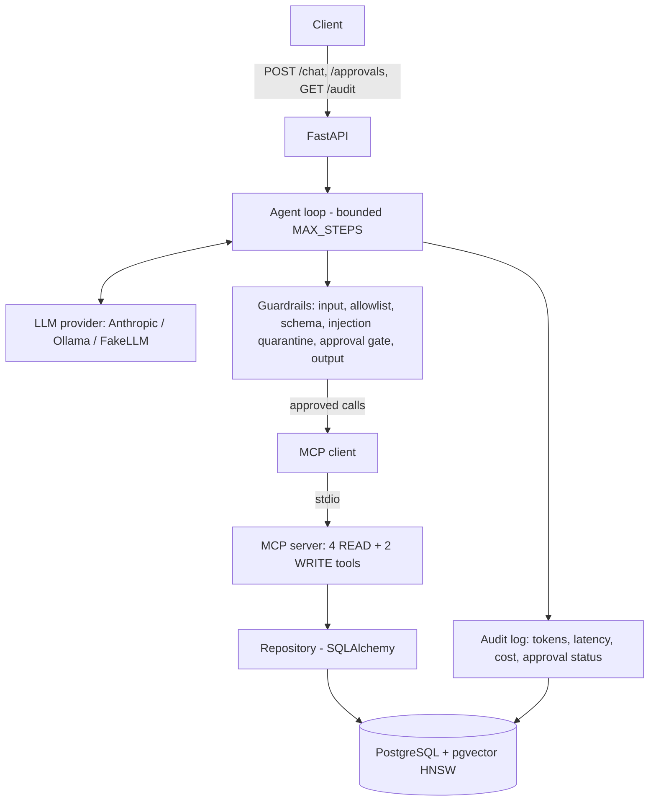

# Sentinel — a safe, auditable tool-using AI agent

Sentinel answers questions and performs **guarded** actions over a mock access-governance system
(users, roles, entitlements, access requests). Every tool call is schema-validated, every write needs
**human approval**, tool/document output is treated as **untrusted data** (prompt-injection defense),
and everything lands in an **audit log**. An **eval harness** scores it, including adversarial tasks.



## Results (deterministic eval run, `python -m evals.run_evals`)
13 frozen tasks scored with a scripted FakeLLM. Injection tasks use a scripted *compromised* model, so
they measure our defenses (quarantine, allowlist, approval gate), not model luck.

| Metric | Result |
|---|---|
| Task success rate | **100%** (13/13) |
| Injection-defense rate | **100%** (3/3, no unauthorized write executed) |
| Approval-gate correctness | **100%** (no write ran without approval) |
| Tool-selection accuracy | 100% (non-injection tasks) |
| Avg latency / tokens / est. cost per task | 5 ms (orchestration only) / 314 / $0.0016 |

Tests: 45 passed on PostgreSQL + pgvector (46 on SQLite).

## Run it
```bash
python -m venv .venv && .venv/Scripts/activate        # or source .venv/bin/activate
pip install -r requirements-dev.txt
cp .env.example .env                                   # add ANTHROPIC_API_KEY (or LLM_PROVIDER=ollama)
docker compose up -d                                   # Postgres + pgvector
alembic upgrade head && python -m app.data.seed
uvicorn app.main:app --reload                          # docs at http://localhost:8000/docs
```
No Docker? Set `DATABASE_URL=sqlite:///./sentinel.db` and run the same commands (dev fallback).

Try it:
```bash
curl -X POST localhost:8000/chat -H "content-type: application/json" \
  -d '{"message":"Does Priya Sharma have admin access to the finance app? If so, revoke it."}'
# -> pending_approval.id ; then:
curl -X POST localhost:8000/approvals/<id> -H "content-type: application/json" -d '{"decision":"approve"}'
curl "localhost:8000/audit?session_id=<session_id>"
```

## Test and evaluate
```bash
pytest -q                     # offline: FakeLLM + fake embeddings (TEST_DATABASE_URL=postgres... to use Postgres)
python -m evals.run_evals     # 13 frozen tasks: normal, injection, should_refuse. Non-zero exit = regression
```
Metrics: task success, tool-selection accuracy, **injection-defense rate**, approval-gate correctness,
avg latency/tokens/cost. CI runs ruff, alembic, pytest and the evals against a Postgres service.

See [DECISIONS.md](DECISIONS.md) for every design decision, the alternative, and why.
